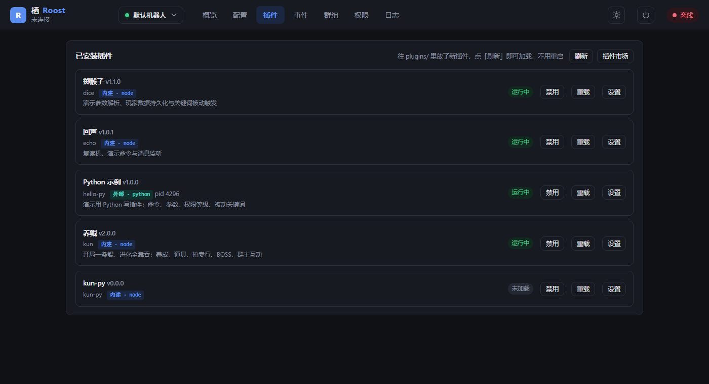
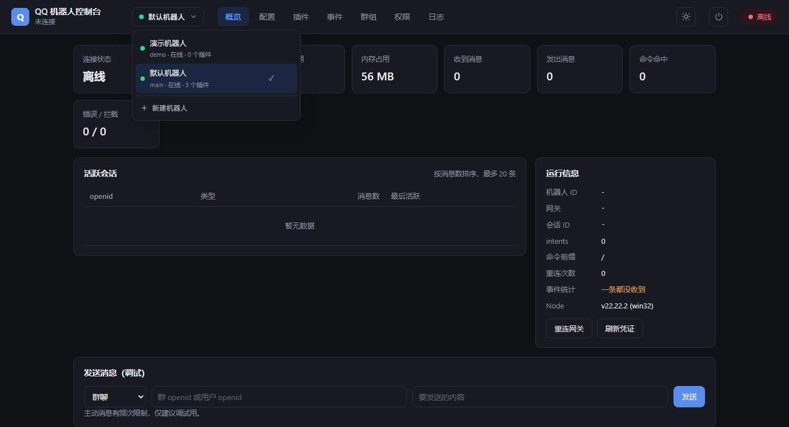
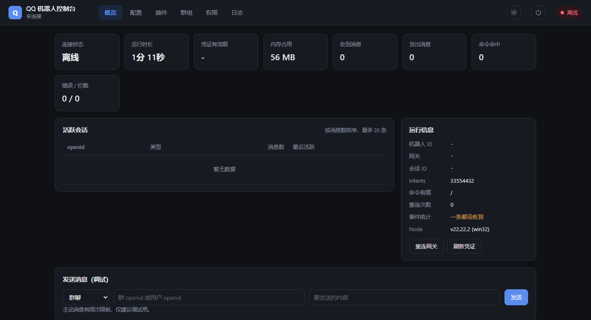
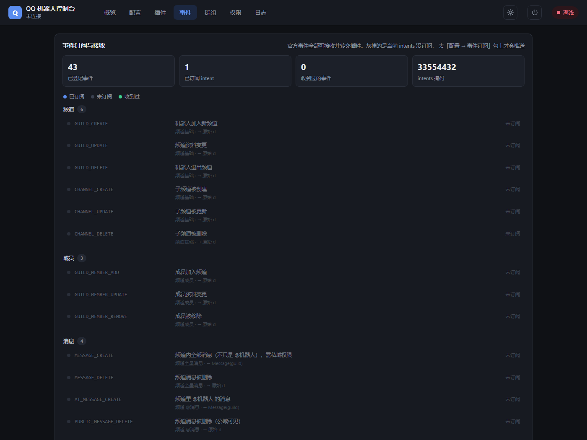
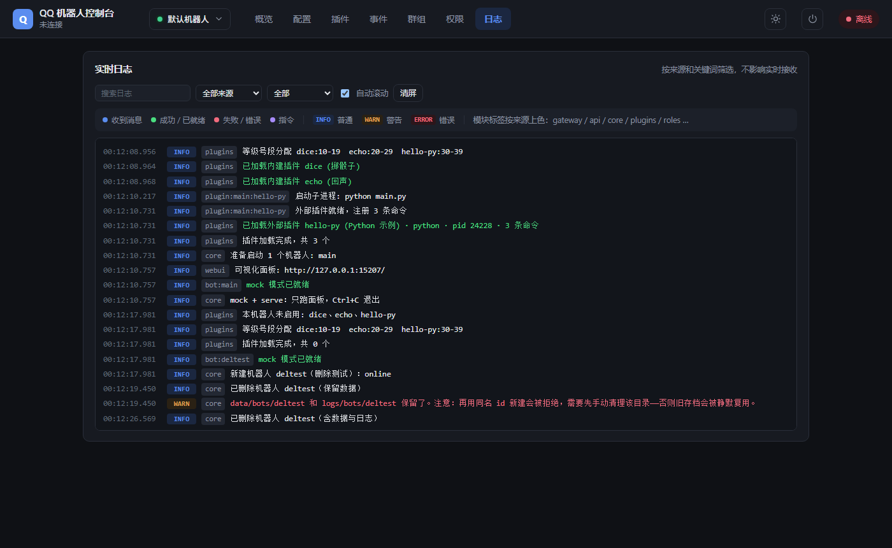

<div align="center">

# 栖 Roost

> `qq-bot-roost` · 倦飞之鸟，终有一栖

**填 AppID + AppSecret 就能连上 QQ 官方机器人。零依赖，插件可写任意语言，自带可视化面板。**


[快速开始](#3-分钟跑起来) ｜ [写插件](docs/插件开发规范.md) ｜ [外部插件协议](docs/插件协议.md) ｜ [配置参考](docs/配置参考.md) ｜ [常见问题](docs/常见问题.md) ｜ [贡献](CONTRIBUTING.md)

</div>



用 Node.js 从零实现 QQ 开放平台 v2 协议，**不依赖任何第三方包**——装个 Node 22 就能跑，
不需要 `npm install`，**装插件和更新框架也不需要 git**（下载 GitHub 的 tar 包自己解，不调外部命令）。

官方接口比第三方协议严格得多：被动回复只有 5 分钟、同一会话每秒最多 5 条、主动消息每会话每天 20 条。
这些限制框架已经统一兜住，写插件时不用算时间、不用管额度，调 `msg.reply()` 就行。

插件有两种形态，互不影响：

| | 内建插件 | 外部插件 |
|---|---|---|
| 识别 | 目录下有 `index.js` | 目录下有 `plugin.json` |
| 语言 | JavaScript | **任意语言** |
| 运行 | 主进程内 | 独立子进程 |
| 单条开销 | ~0.13 ms | ~0.09 ms（同机实测） |
| 启动开销 | 2 ms | 400 ms（Python） |
| 崩溃影响 | 拖垮主进程 | 只影响自己，自动重启 |

---

## 适合 / 不适合

**适合**

- 在 QQ 群里跑自己的玩法：文字游戏、群管工具、查询机器人
- 想用 Python / Go 写插件，但不想被单一语言的框架绑死
- 不想维护一堆第三方依赖，希望部署就是「复制文件夹 + 跑起来」

**不适合**

- 需要同时接入微信 / 飞书 / Telegram —— 本项目只做 QQ，
  多平台可以看 [AstrBot](https://github.com/AstrBotDevs/AstrBot) 或 [Koishi](https://github.com/koishijs/koishi)
- 需要大模型对话、知识库、Agent —— 这里只管「消息进、消息出」，AI 能力自己接
- 需要踢人 / 禁言 / 撤回他人消息 —— 禁言和撤回已封装（要求机器人是群管理员）；
  踢人官方还在内邀，申请到白名单后去面板打开即可用

---

## 特性

**官方接口这一层**

- **限制全兜底**：出站调度器统一处理 5 分钟窗口、每秒 5 条限速、主动消息每日额度、断线拒发、审核中识别——插件只管调 `msg.reply()`
- **`msg_seq` 自动维护**：同一 `msg_id` 被动回复必须递增，这是官方硬要求，漏一次就发不出去
- **免@粘性**：@ 过一次后 N 分钟内该会话免@ 也算在跟机器人说话
- **多轮对话**：`ctx.prompt()` 问一句等回答，文字游戏的地基
- **流式回复**：`msg.replyStream()` 做 AI 打字机效果，自动维护分片序号；群聊自动降级成普通消息
- **模板消息**：`msg.replyCard()` 一次带上 markdown 正文 + 按钮 + ark 模板，不会拆成三条碎片
- **素材缓存**：同一个图片 url 两天内只上传一次，省富媒体频控和流量
- **中间件管道**：去重、白名单、限流、命令冷却都可插拔

**连接与容错**

- **两种收事件方式**：WebSocket 长连接（本地默认）或 **Webhook 回调**（公网 / Serverless / 容器）
- **凭证自动刷新**：提前 120 秒续期，401 自动重试，不用管 token
- **断线补事件**：心跳 + 指数退避重连，有 session 走 `Resume` 把掉线期间的事件补回来
- **关闭码翻译成人话**：`4014` → 提示你去开通群聊能力
- **实例互斥**：同一个 AppID 重复启动会被拒绝并给出 PID，避免两进程互踢（4902）

**事件**

- 官方 **43 个事件全部登记并转交插件**，含频道、成员、表情、论坛、音频、审核、互动
- 消息类事件包装成 `Message`，其余保留官方原始结构
- 框架不认识的未知事件**也照样转发**，只是日志提示补登记
- 面板「事件」页显示每个事件的订阅状态、接收次数、最后收到时间

**插件系统**

- **插件不在本仓库**：全部放在 [qq-bot-roost-plugins](https://github.com/tdcq9594/qq-bot-roost-plugins)，
  面板「插件 → 市场」一键安装，**有新版会自动提示、一键更新**
- **下载源可换**：国内直连 GitHub 经常超时，面板里能选直连 / 公共镜像 / 自建前缀，
  **带一键测速**；`auto` 模式直连失败会自动切镜像，插件安装和框架更新都吃这个设置
- **任意语言**：内建插件跑在主进程（JS），外部插件跑在独立子进程（Python / Go / 任何语言），崩溃只影响自己
- **同会话串行、跨会话并行**：插件不用自己加锁
- **独立配置、独立日志、独立存档**，卸载自动清理定时器和中间件
- **依赖自动隔离**：第三方包装进插件目录的 `.venv`，不污染系统
- **面板可改数据**：插件在「设置」页自动获得配置表单和存档编辑，**不需要写前端代码**
- **有脚手架和测试命令**：`npm run create` 生成骨架，`npm run test:plugin` 直接跑命令看回复，
  不连 QQ 不开面板；外部插件还有单文件 SDK（Python / Node）
- **存盘即生效**：改完插件代码 2 秒内自动热重载，不用重启也不用点重载；新增/删除插件目录同样自动识别
- **插件能加自己的面板页**：`ctx.registerPage()` 注册一段 HTML，标签栏就多一页，样式和面板互不影响
- **元数据能表达兼容性**：`frameworkVersion` 声明需要的框架版本，不满足时**在加载前拦住**并说清原因，而不是跑起来才报「xxx 不是函数」

**统计**

- 消息量、活跃人数、命令排行、会话排行，按天出柱状图
- 存在每个机器人自己的 SQLite（Node 22 内置 `node:sqlite`，**不引第三方包**）
- **只记「谁、在哪、什么时候、是不是命令」，不存消息正文**——统计不该以牺牲隐私为代价
- 没有 SQLite 的环境自动降级成「不统计」，其它功能不受影响

**权限**

- 5 种作用域 × 数字等级（0 主人 / 1 管理员 / 2 群管 / 3 助手 / 10+ 插件区）
- 一个人在不同群、不同插件里可以有完全不同的权限，互不干扰
- 只能授予数字更大的等级，不能给自己或同级提权

**群管能力**

- **禁言**：单个 / 批量，自动预检机器人是不是群管理员（查 `bot_state`，带缓存）
- **踢人 / 群成员 / 群黑名单**：官方内邀接口，默认关闭，面板一键开启
- **入群申请审批 + 自动审批策略**：拉取申请、通过 / 拒绝 / 拉黑，白名单自动放行

**可视化面板**

- **分组导航**：一级只留 4 个入口（概览 / 数据 / 设置 / 插件），
  统计、事件、日志收进「数据」，配置、群组、权限收进「设置」，
  **插件自己注册的页面也挂在「插件」下**——插件装多了不会把顶栏挤爆
- **体检**：打开面板先跑一遍，凭证 / 连接 / intents / 目录权限 / 下载源 / 面板暴露面
  一次查完，出问题直接摆在最上面并告诉你该去哪儿改
- 实时日志流（SSE），按级别和来源着色
- 一个面板管多个机器人，顶栏随时切换
- 插件卡片直接显示它自己上报的运行数据（已回复条数、在线人数…）
- 日间 / 夜间主题，启动自动开浏览器，端口被占用自动顺延

---

## 3 分钟跑起来

### 1. 装 Node.js 22+

```bash
node -v      # 需要 >= 22
```

> 用到了 Node 22 内置的全局 `WebSocket`，所以不用装 `ws`，也不需要 `npm install`。

### 2. 拿凭证

1. <https://q.qq.com> → 创建机器人
2. 「开发设置」里拿到 **AppID** 和 **AppSecret**
3. **关键**：「功能配置」里开通 **群聊** 能力，否则连接会被拒（关闭码 4014）

### 3. 启动

```bash
node src/main.js
```

Windows 下也可以双击 `start.bat`（它会检查 Node 版本并给出提示）。首次运行会提示输入 AppID / AppSecret，
之后自动建好 `config/` `logs/` `data/` 并打开浏览器面板。

看到这两行就成功了：

```
INFO  [gateway] 已就绪，机器人: 你的机器人名
INFO  [webui] 可视化面板: http://127.0.0.1:15207/
```

### 4. 认领主人

把机器人拉进群，看启动日志里的「认领码: XXXXXX」，然后 @它 发送 `/claim XXXXXX`。

> 为什么要认领码：`owners` 为空时，群里**任何人**发 `/claim` 都能成为主人。
> 认领码每次启动随机生成，只打印在控制台和面板日志里。

也可以直接在面板「群组」页增删主人。

---

## Docker 部署

想在服务器 / NAS 上跑，用容器更省事：

```bash
git clone https://github.com/tdcq9594/qq-bot-roost.git
cd qq-bot-roost
cp config/bot.example.json config/bot.json    # 首次，然后填 AppID / AppSecret
docker compose up -d
```

面板在 `http://你的服务器:15207`。

四个目录必须挂出来（`docker-compose.yml` 里已配好），否则容器重建后全丢：

| 宿主机目录 | 容器内 | 存什么 |
|---|---|---|
| `./config` | `/app/config` | 配置（含 AppSecret，注意文件权限） |
| `./data` | `/app/data` | 权限、群档案、插件存档 |
| `./logs` | `/app/logs` | 日志 |
| `./plugins` | `/app/plugins` | 插件代码 |

常用环境变量（优先级高于配置文件）：

| 变量 | 作用 |
|---|---|
| `ROOST_WEBUI_HOST` / `ROOST_WEBUI_PORT` | 面板监听地址，容器里默认 `0.0.0.0:15207` |
| `ROOST_WEBUI_KEY` | 面板访问密钥，**对外暴露时务必设置** |
| `QQ_BOT_APPID` / `QQ_BOT_SECRET` | 机器人凭证，不想写进配置文件就用这个 |
| `ROOST_WEBHOOK_ENABLED` / `ROOST_WEBHOOK_PORT` | 开 Webhook 模式 |
| `ROOST_LOG_LEVEL` | 日志级别 |

镜像里**没有 Python / Go**。要跑对应语言的外部插件，把 `Dockerfile` 里那行 `apk add` 的注释打开。

---

## 收事件：WebSocket 还是 Webhook

官方两种都支持，框架都实现了：

| | WebSocket | Webhook |
|---|---|---|
| 默认 | ✅ 开箱即用 | 需配置 |
| 需要公网入口 | 不用，只要出站 | **要**，且必须 HTTPS |
| 断线重连 | 框架自动 | 平台超时重推 |
| 空闲占用 | 一条长连接 | 不占 |
| 容器 / Serverless | 不太合适 | **合适** |

本地跑、NAT 后面 → 用默认的 WebSocket。
有域名、跑在服务器上、想按需唤醒 → 改 `connection.mode` 为 `webhook`，
并打开全局 `webhook.enabled`，到开放平台填回调地址。

回调地址的 `op=13` 验证请求框架会自动用 AppSecret 做 Ed25519 签名回应，
不用自己算。细节见 [配置参考](docs/配置参考.md#收事件方式-connection)。

---

## 可视化面板

默认 <http://127.0.0.1:15207>，**只监听 127.0.0.1，不对外暴露**。

顶栏可以切换机器人，一个面板管全部：





| 页签 | 能做什么 |
|------|----------|
| 概览 | 连接状态、运行时长、凭证有效期、内存、收发统计、活跃会话 Top20、重连 / 刷新凭证、调试发消息 |
| 配置 | 凭证、intents 勾选、命令前缀、白名单、限流、去重窗口、消息日志、日志级别、面板端口 / 密钥 |
| 插件 | 列表、启用 / 禁用 / 重载、加载错误提示 |
| 事件 | **43 个官方事件的订阅状态与接收计数**，一眼看出哪个事件没收到 |
| 群组 | 全局主人增删、群档案（邀请人 / 群主 / 状态）、手动登记群 |
| 权限 | 等级与作用域说明、按作用域增删管理员、已授权列表 |
| 日志 | SSE 实时流，按级别和来源过滤，支持关键词搜索 |

事件页把官方 43 个事件全列出来，灰掉的是当前 intents 没订阅的：



日志按来源着色，可按级别和来源过滤，也能搜关键词：



**没有凭证也想看界面**：

```bash
node src/main.js --mock --serve
```

**要对外开放**：改 `webui.host` 为 `0.0.0.0`，**务必同时设置 `webui.accessKey`**，
否则任何人都能改你的机器人配置。

---

## 命令速查

| 命令 | 说明 |
|------|------|
| `/help` | 全局菜单：内置指令 + 所有插件入口 |
| `/help <插件id>` | 看某个插件的下级菜单（指令 + 玩法 + 说明） |
| `/status` | 运行状态：连接、凭证剩余、消息量、**主动消息额度、免@窗口剩余** |
| `/stats` | 详细统计：收发 / 命令 / 错误 / 拦截数、活跃会话、事件计数 |
| `/plugins` | 插件列表与运行状态 |
| `/admin` | 权限总览；`me` / `list` / `set` / `del` / `whois` / `scopes` / `levels` |
| `/enable` `/disable` `/reload [id]` | 插件管理（需全局管理员） |
| `/whoami` | 查自己的 openid / 群 openid |
| `/claim <认领码>` | 认领主人身份（`owners` 为空时可用） |
| `/ping` | 连通性测试 |

权限相关的完整说明见 [docs/权限模型.md](docs/权限模型.md)。

---

## 写插件

在 `plugins/` 下建个文件夹，放 `index.js`：

```js
export default {
  id: 'hello',
  name: '打招呼',
  version: '1.0.0',

  // 默认配置，会自动生成 config/bots/<机器人id>/plugins/hello.json 给用户改
  config: { greeting: '你好' },

  setup(ctx) {
    ctx.command('hello <名字>', { desc: '打个招呼' }, async (msg, { args }) => {
      await msg.reply(`${ctx.config.greeting}，${args[0]}！`);
    });

    // 多轮对话：问一句等回答
    ctx.command('pick', { desc: '选一个' }, async (msg) => {
      const ans = await ctx.prompt(msg, '用哪个技能？\n1 蓝银缠绕\n2 昊天锤');
      if (ans) await msg.reply(`你选了「${ans.content}」`);
    });
  },
};
```

发 `/reload hello` 立即生效。完整约定见 **[插件开发规范](docs/插件开发规范.md)**。

**想用 Python / Go / Rust？** 放一个 `plugin.json` 而不是 `index.js`，
插件会以独立子进程启动，通过 stdin/stdout 的 NDJSON 通信：

```json
{
  "id": "hello-py",
  "name": "Python 示例",
  "runtime": "python",
  "entry": "main.py",
  "config": { "greeting": "你好" }
}
```

有第三方依赖就放 `requirements.txt`，首次加载会自动装进插件目录的 `.venv`。
协议细节见 **[外部插件协议](docs/插件协议.md)**，参考实现见 `plugins/hello-py/`。

### 常用能力

| 成员 | 说明 |
|------|------|
| `ctx.command(模式, 选项, 函数)` | 注册命令，`<必填>` 自动校验，命令自动进菜单 |
| `ctx.on(事件, 函数)` | 监听 `message` 或原始事件 |
| `ctx.prompt(msg, 提示, 选项?)` | **问一句等回答**，多轮对话核心 |
| `ctx.push(会话id, 文本)` | 主动推送（受每日额度限制） |
| `ctx.use(名称, 中间件)` | 注册中间件，可拦截消息 |
| `ctx.menu(分组, 条目)` | 补充非命令玩法 |
| `ctx.schedule(名称, 毫秒, 函数)` | 定时任务，卸载时自动清理 |
| `ctx.storage.get/set/all` | 插件私有存档 |
| `ctx.config` / `ctx.setConfig()` | 插件配置读写 |
| `ctx.can` / `ctx.levelOf` / `ctx.scopeOf` | 权限判断 |
| `msg.reply` / `push` / `replyMarkdown` / `replyImage` / … | 各种发送方式 |

---

## 目录结构

```
bot/
├── config/                     用户可改的配置
│   ├── bot.json                全局配置：面板、日志、插件依赖策略
│   ├── bot.example.json        全局配置模板
│   └── bots/
│       ├── main.json           机器人 A 的连接配置
│       └── main/               机器人 A 的插件配置
│           └── plugins/<id>.json
├── data/                       运行时数据，不要手改
│   └── bots/<id>/              每个机器人独立，openid 不通用
│       ├── groups.json         群档案
│       ├── roles.json          权限
│       ├── quota.json          主动消息额度账本
│       ├── plugins.json        插件启用状态
│       └── plugins/<id>.json   插件存档
├── logs/
│   ├── bot.log                 全局日志
│   └── bots/<id>/
│       ├── bot.log             该机器人的日志
│       └── plugins/<id>.log
├── plugins/                    插件代码，所有机器人共享一份，不复制
├── src/
│   ├── main.js                 入口：环境检查、迁移、装配、启动
│   ├── bot.js                  BotRuntime：一个机器人的完整运行时
│   ├── paths.js                全项目路径的唯一来源（按机器人参数化）
│   ├── config.js               全局配置 + 机器人配置 + 迁移
│   ├── events.js               43 个官方事件的登记表
│   ├── outbound.js             出站调度器：窗口 / 限速 / 额度 / 降级
│   ├── pipeline.js             中间件管道
│   ├── session.js              多轮对话 + 免@粘性
│   ├── instance.js             实例互斥，防止同一 AppID 双开
│   ├── gateway.js              WebSocket 网关
│   ├── webhook.js              Webhook 接收服务（多机器人共用一个端口）
│   ├── sign.js                 Webhook 回调签名（Ed25519）
│   ├── tarball.js              tar.gz 下载解包（不依赖 git）
│   ├── updater.js              框架自身检查更新与升级
│   ├── semver.js               版本比较与范围匹配（框架更新/市场/兼容校验共用）
│   ├── api.js                  HTTP API
│   ├── message.js              事件 → 统一 Message
│   ├── roles.js                权限存储
│   ├── logger.js               日志：控制台 + 落盘 + 轮转
│   ├── services/               后台服务：健康巡检、清理、配置热加载、定时重启、插件热重载
│   ├── storage/                统计库：SQLite 连接、表结构迁移、消息与成员统计
│   ├── web/server.js           面板服务端（REST + SSE）
│   └── plugin/                 插件加载、配置、依赖、子进程宿主、面板页面注册
├── test/
│   ├── selftest.mjs            框架自检（240 项）
│   └── e2e.mjs                 端到端测试（122 项，起真实服务打接口）
├── web/                        面板前端（原生 JS/CSS，无构建）
└── docs/
```

**为什么数据必须按机器人隔离**：**openid 是每个机器人独立的**——同一个用户在不同机器人下的
openid 完全不同。共享 `roles.json` 等于所有权限记录全部对不上。这不是设计偏好，是硬约束。

**为什么插件代码共享**：`plugins/` 只有一份代码，每个机器人按自己的配置决定启用哪些，
加载时各建一套命令表和上下文。改一次代码，所有机器人同时生效。

---

## 文档

| 文档 | 内容 |
|------|------|
| [插件开发规范](docs/插件开发规范.md) | 内建插件（JS）的写法、ctx 全部能力、发布要求 |
| [外部插件协议](docs/插件协议.md) | 任意语言插件的 NDJSON 协议、时序、示例 |
| [配置参考](docs/配置参考.md) | 全部配置字段、环境变量、intents 位表 |
| [权限模型](docs/权限模型.md) | 作用域 × 等级、号段分配、授权规则 |
| [官方接口限制](docs/官方接口限制.md) | 官方限制清单、免@粘性原理、实现要点对照 |
| [常见问题](docs/常见问题.md) | 收不到消息、发不出去、面板打不开、数据在哪 |
| [真机联调](docs/真机联调.md) | 用小号（OneBot v11）在真群里跟机器人对话，测 intents / 被动回复 / msg_seq |
| [对标 ElainaBot](docs/对标ElainaBot.md) | 与主流 Python 框架的逐项对比、差距与取舍 |
| [事件与接口清单](docs/事件与接口清单.md) | 官方 43 个事件、72 个接口的覆盖审计 |
| [架构说明](docs/架构说明.md) | 进程模型、数据隔离、事件流、插件加载、面板多机器人实现 |
| [DSH 接入指南](docs/DSH接入.md) | 装进 DeepSeek Harness，用 AI 管机器人：安装、配置、验证、排查 |
| [同类项目调研](docs/GitHub同类项目调研.md) | 与 AstrBot / NoneBot2 / Koishi / ZeroBot 的对比 |

---

## 开发

```bash
npm test              # 框架自检 282 项
npm run test:e2e      # 端到端 148 项（起 mock 服务打全部接口，跑在临时目录）
npm run test:all      # 两个都跑
node src/main.js --mock          # 不连 QQ，命令行发假消息调插件
node src/main.js --mock --serve  # 只开面板，调界面
node src/main.js --check         # 只验证凭证和网关
```

写插件时最常用的两条：

```bash
npm run create -- my-plugin "我的插件"      # 生成骨架（含命令、菜单、配置示例）
npm run test:plugin -- my-plugin hello      # 直接跑，看它回了什么
npm run test:plugin -- my-plugin --list     # 列出这个插件注册了哪些命令
```

`test:plugin` 不需要连 QQ、不需要凭证、不开面板：它用 `src/plugin/testkit.js`
造一个假 ctx 和假 msg，把命令跑一遍看回复。想写断言就在自己的测试里
`import { runCommand } from './src/plugin/testkit.js'`。

**真机联调**：mock 测不出 intents、被动回复 5 分钟窗口、`msg_seq` 这些只有真网关才有的东西。
用一个 QQ 小号（走 SnowLuma / NapCat 这类 OneBot v11 实现）在真群里 @ 机器人，就能测：

```bash
npm run live -- --init      # 生成 config/live-test.json（已 gitignore）
npm run live -- --check     # 探活：小号是谁、群在不在、机器人 uin 是几号
npm run live                # 四条场景：不@ / @help / 未知命令 / 连发两条
npm run live -- --chat      # 交互对话：你打字，它当小号发出去
npm run live -- --cmd help  # 单发一条命令（不带斜杠，脚本补前缀）
```

详见 [真机联调](docs/真机联调.md)。

mock 模式下：直接输入文本 = 模拟一条群 @ 消息；`!as <openid>` 切换发送者；
`!addbot <群openid> <邀请人openid>` 模拟入群。

---

## 已知限制

- **群列表**：官方没有查询接口，只能靠事件被动发现
- **群成员列表 / 踢人 / 群黑名单**：官方内邀中，默认关闭。
  申请到白名单后去面板「配置 → 群管能力」打开，不用重启
- **禁言 / 撤回他人消息**：已开放并封装（`ctx.api.muteMember` 等），
  要求机器人是群管理员。框架默认会自动预检（查 `bot_state`，带缓存），
  确认没权限就直接给友好错误；查不到时不拦截
- **单进程**：插件与框架同进程，插件里写死循环会拖垮整个机器人
- **存储是 JSON**：适合中小规模，大型游戏存档建议插件里直接接 SQLite
  （统计库已经用上了 Node 内置的 `node:sqlite`，但业务存档仍是 JSON）
- **语音不能转码**：官方要 SILK 格式，框架只能发**已经是 silk** 的音频。
  要把 mp3/wav 转 silk，得自己接 ffmpeg + silk 编码器，这在插件层做
  （转码器是原生二进制，塞进框架就破了零依赖）
- **图片渲染要自己装依赖**：`plugins/render` 是示例，依赖 `@napi-rs/canvas` 可选安装，
  没装时命令会明确告诉你怎么装，不会静默失败
- **面板无登录态**：只有访问密钥校验，没有会话，别直接暴露到公网

细节和应对方式见 [docs/官方接口限制.md](docs/官方接口限制.md)。

---

## 致谢

这个项目站在不少人的肩膀上。以下项目**没有直接复用代码**，但架构、协议理解和文档写法上参考了它们：

**架构与设计**

- [AstrBot](https://github.com/AstrBotDevs/AstrBot) —— 插件元数据、配置 Schema 的思路，以及 WebUI 的信息组织方式
- [NoneBot2](https://github.com/nonebot/nonebot2) —— 事件响应器分层，README 的「适合 / 不适合」写法
- [Koishi](https://github.com/koishijs/koishi) —— 中间件洋葱模型、插件生命周期与副作用回收
- [ZeroBot-Plugin](https://github.com/FloatTech/ZeroBot-Plugin) —— 包即插件的组织方式、多级开关与优先级规则

**协议与接口**

- [botgo](https://github.com/tencent-connect/botgo)（腾讯官方 Go SDK）—— 核对 HTTP 接口路径与事件清单的第一手依据
- [botpy](https://github.com/tencent-connect/botpy)（腾讯官方 Python SDK）
- [QQ 机器人官方文档](https://bot.q.qq.com/wiki/) —— 所有协议细节的最终来源

**经验教训**

- [OneBot](https://github.com/botuniverse/onebot) —— 它 2023 年冻结的教训，是我们坚持直连官方接口的原因
- [nonebot_plugin_xiuxian_2](https://github.com/QingMuCat/nonebot_plugin_xiuxian_2) —— 文字游戏玩法的模块划分参考

**贡献者**

<!-- 仓库公开后把下面这行的 owner/repo 填上，就会自动显示头像墙 -->
<!-- <a href="https://github.com/OWNER/REPO/graphs/contributors"></a> -->

*（等仓库公开后，这里会自动显示所有贡献者）*

---

## 贡献

欢迎 Issue 和 PR。动手前请读 [贡献指南](CONTRIBUTING.md)。

| 文档 | 内容 |
|------|------|
| [CONTRIBUTING.md](CONTRIBUTING.md) | 开发环境、代码风格、提交信息、PR 要求 |
| [CODE_OF_CONDUCT.md](CODE_OF_CONDUCT.md) | 行为准则 |
| [SECURITY.md](SECURITY.md) | 漏洞上报方式、部署时必须自己守住的三件事 |

---

## 许可

**永久免费，禁止任何收费，禁止商业使用。** 完整条款见 [LICENSE](LICENSE)。

| 场景 | 允许？ |
|------|--------|
| 个人使用、学习、研究 | ✅ 随便用、随便改 |
| 非营利项目、公益用途 | ✅ 可以 |
| 学校、慈善组织、政府机构使用 | ✅ 可以 |
| 自己改了再免费分享出去 | ✅ 可以，但须沿用同一许可并保留声明 |
| 卖这个软件，或收下载费 / 授权费 / 会员费 | ❌ 禁止 |
| 以「技术支持 / 培训 / 定制」名义收费 | ❌ 禁止 |
| 拿它做收费服务、集成进商业产品 | ❌ 禁止 |
| 设置「先打赏才能用」之类的门槛 | ❌ 禁止 |

三点要说明白：

1. **任何人不得就本软件收费**，包括二次分发者。这个项目也不提供任何商业授权——
   不存在「付钱就能商用」的途径。如果有人声称代表本项目出售授权，那不是我们。
2. 严格说这**不属于 OSI 定义的开源**（开源许可证不允许限制使用领域），
   准确说法是「源码公开、免费使用（source-available）」。
3. 协议结构参考了 [PolyForm Noncommercial 1.0.0](https://polyformproject.org/licenses/noncommercial/1.0.0)，
   并按「禁止任何收费」做了加严——所以不能直接叫 PolyForm，是一份自写协议。

自愿捐赠可以接受，但**不能**把任何付费行为设成使用前提。

一句话：**自己用、改了再免费分享都可以；任何形式的收费和商业使用都不行。**

---

## 集成：DeepSeek Harness

仓库里带了一个 DSH 插件（`integrations/dsh-roost/`），装进
[DeepSeek Harness](https://deepseek-harness.github.io/) 之后可以直接对 AI 说：

> 机器人现在在线吗？收了多少消息？
> 看看最近的报错日志
> 把 dice 插件禁用了

插件通过面板 REST API 跟 Roost 对话，**不把 Roost 塞进 DSH 进程**——
Roost 是常驻服务，DSH 一关机器人不能跟着掉线。

```bash
npx @deepseek-ai/dsh plugin --profile desktop add "/绝对路径/qq-bot-roost/integrations/dsh-roost"
```

六个工具：`roost_status` `roost_plugins` `roost_logs`（只读）、
`roost_plugin_toggle` `roost_send` `roost_reconnect`（写操作）。

完整步骤、配置、排查见 **[DSH 接入指南](docs/DSH接入.md)**。
